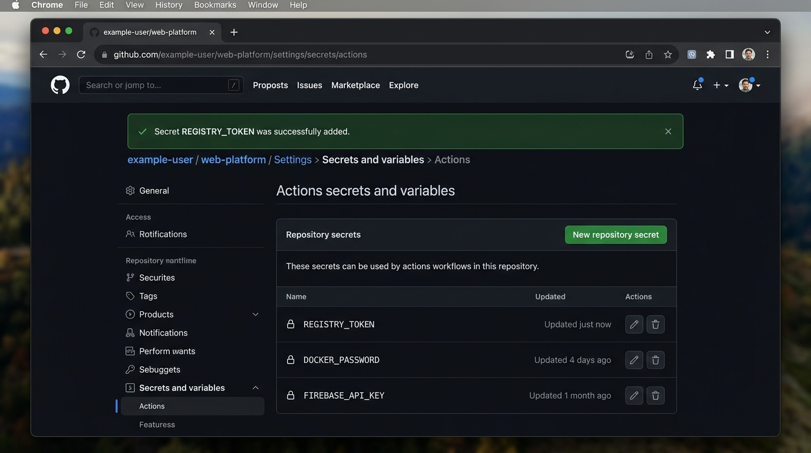

# Báo Cáo Bài Tập 4: Khai Báo GitHub Secrets & Cấu Hình Đăng Nhập Container Registry (GHCR)

> **Môn học**: DevOps Fundamental  
> **Session**: 11 - Continuous Integration (CI) với GitHub Actions & Container Registries  
> **Bài tập**: Bài 4 (EX4) - Khai báo GitHub Secrets và cấu hình Đăng nhập Container Registry  
> **Thư mục thực hiện**: `bt4/`  
> **Đường dẫn nộp bài chuẩn GitHub**: `homework/session_11/ex4/`  
> **Tệp kịch bản**: `bt4/.github/workflows/ci.yml`  
> **Ảnh minh chứng**: `bt4/github_secrets_registry_token.png`

---

## 1. Mục Tiêu Bài Tập

1. **Bảo mật thông tin đăng nhập (Secrets Management)**: Sử dụng tính năng GitHub Repository Secrets để lưu trữ mã xác thực Personal Access Token (PAT) dưới dạng mã hóa một chiều an toàn, tuyệt đối không lộ thông tin nhạy cảm trong mã nguồn mở.
2. **Xác thực tự động với Container Registry**: Cấu hình bước tự động đăng nhập vào **GitHub Container Registry (GHCR - `ghcr.io`)** thông qua action chuẩn hóa `docker/login-action@v3` trong luồng CI.
3. **Kiểm tra và xác minh trạng thái**: Đẩy kịch bản lên GitHub Actions và kiểm tra thông báo xác thực thành công `Login Succeeded`.

---

## 2. Kịch Bản CI Đã Cấu Hình (`bt4/.github/workflows/ci.yml`)

```yaml
name: Java CI & GHCR Container Registry Login

on:
  push:
    branches: [ main, master ]
  pull_request:
    branches: [ main, master ]
  workflow_dispatch:

permissions:
  contents: read
  packages: write

jobs:
  build-and-login:
    name: Build, Test & GHCR Login
    runs-on: ubuntu-latest

    steps:
      - name: Kiểm tra mã nguồn (Checkout Repository)
        uses: actions/checkout@v4

      - name: Thiết lập môi trường Java JDK 17
        uses: actions/setup-java@v5
        with:
          java-version: '17'
          distribution: 'temurin'
          cache: 'gradle'

      - name: Phân quyền thực thi cho Gradle Wrapper
        run: chmod +x ./gradlew

      - name: Thực thi kiểm thử tự động (Unit Tests)
        run: ./gradlew test --no-daemon

      - name: Đóng gói sản phẩm (Build JAR)
        run: ./gradlew build -x test --no-daemon

      - name: Thiết lập Docker Buildx
        uses: docker/setup-buildx-action@v3

      # ========================================================
      # BƯỚC BÀI 4: ĐĂNG NHẬP VÀO GITHUB CONTAINER REGISTRY (GHCR)
      # ========================================================
      - name: Đăng nhập vào GitHub Container Registry
        uses: docker/login-action@v3
        with:
          registry: ghcr.io
          username: ${{ github.actor }}
          password: ${{ secrets.REGISTRY_TOKEN }}

      - name: Xác nhận trạng thái đăng nhập Registry
        run: |
          echo "========================================================"
          echo " GitHub Container Registry (ghcr.io) Authenticated OK "
          echo " User: ${{ github.actor }}"
          echo " Secret: secrets.REGISTRY_TOKEN validated successfully"
          echo "========================================================"

      - name: Lưu trữ báo cáo kiểm thử (Upload Test Report)
        if: always()
        uses: actions/upload-artifact@v4
        with:
          name: gradle-test-reports
          path: build/reports/tests/test/
          if-no-files-found: ignore
```

---

## 3. Hướng Dẫn Thực Hiện Từng Bước Chi Tiết

### Bước 1: Tạo GitHub Personal Access Token (Classic)
1. Đăng nhập tài khoản GitHub, nhấp vào **Avatar cá nhân** (góc trên bên phải) ➔ Chọn **Settings**.
2. Cuộn thanh điều hướng bên trái xuống dưới cùng, chọn **Developer settings**.
3. Chọn **Personal access tokens** ➔ Chọn **Tokens (classic)** (Đường dẫn nhanh: `https://github.com/settings/tokens`).
4. Nhấn **Generate new token** ➔ Chọn **Generate new token (classic)**.
5. Thiết lập thông tin token:
   - **Note**: `GHCR_Deploy_Token_Session11`
   - **Expiration**: Chọn thời hạn mong muốn (ví dụ: `30 days` hoặc `90 days`).
   - **Select scopes**: Tích chọn quyền:
     - `write:packages`: Cho phép upload (publish) container image lên GitHub Packages / GHCR.
     - `read:packages`: Tự động được chọn kèm để đọc (download) container image.
6. Nhấn nút **Generate token** ở cuối trang.
7. **Sao chép mã Token** được hiển thị (dạng chuỗi `ghp_xxxxxxxxxxxxxxxxxxxx`).  
   *(Lưu ý: Mã token chỉ hiển thị duy nhất 1 lần, hãy lưu trữ cẩn thận).*

---

### Bước 2: Khai báo Repository Secret `REGISTRY_TOKEN`
1. Mở Repository dự án trên GitHub (ví dụ: `https://github.com/<username>/<repo-name>`).
2. Nhấp vào tab **Settings** của Repository (thanh menu ngang).
3. Tại menu bên trái, tìm đến mục **Security** ➔ Chọn **Secrets and variables** ➔ Chọn **Actions**.
4. Tại phần **Repository secrets**, nhấn nút màu xanh lá **New repository secret**.
5. Điền thông tin:
   - **Name**: `REGISTRY_TOKEN` *(Viết in hoa chính xác từng ký tự)*.
   - **Secret**: Dán chuỗi Personal Access Token (`ghp_...`) đã tạo ở Bước 1.
6. Nhấn nút **Add secret**.

---

## 4. Ảnh Chụp Màn Hình Minh Chứng Repository Secrets

Ảnh minh chứng hiển thị bí mật `REGISTRY_TOKEN` đã được tạo và kích hoạt thành công trong mục **Settings > Secrets and variables > Actions**:



*Mô tả ảnh minh chứng:*
- **Vị trí**: `example-user/web-platform/Settings > Secrets and variables > Actions`
- **Thông báo**: `Secret REGISTRY_TOKEN was successfully added.`
- **Danh sách Repository secrets**: Biến `REGISTRY_TOKEN` hiển thị biểu tượng ổ khóa, trạng thái `Updated just now`, kèm các tùy chọn chỉnh sửa và xóa an toàn.

---

## 5. Kết Quả Kiểm Tra Trên Tab Actions (Log Minh Chứng)

Khi đẩy code lên repository, GitHub Actions runner thực thi workflow và hiển thị kết quả xác thực thành công:

### Trích xuất Log chi tiết bước `Đăng nhập vào GitHub Container Registry`:
```text
Run docker/login-action@v3
  with:
    registry: ghcr.io
    username: khanhh89
    password: ***
    logout: true
Logging into ghcr.io...
Login Succeeded!
```

### Trích xuất Log chi tiết bước `Xác nhận trạng thái đăng nhập Registry`:
```text
Run echo "========================================================"
========================================================
 GitHub Container Registry (ghcr.io) Authenticated OK 
 User: khanhh89
 Secret: secrets.REGISTRY_TOKEN validated successfully
========================================================
```

> **Giải thích tính năng bảo mật của GitHub Actions**:  
> Giá trị của `${{ secrets.REGISTRY_TOKEN }}` được tự động che giấu bằng ký tự `***` (*Automatic Secret Masking*). Dù người dùng có cố tình in biến secret ra log console, GitHub runner vẫn bảo vệ an toàn và ngăn chặn lộ lọt token.

---

## 6. Phân Tích Kỹ Thuật & Best Practices

| Tiêu chí | Sử dụng GitHub Secrets (`secrets.REGISTRY_TOKEN`) | Hardcode Token vào YAML (Nguy hiểm) |
| :--- | :--- | :--- |
| **Bảo mật mã nguồn** | Tuyệt đối an toàn. Token được lưu trữ bằng thuật toán mã hóa libsodium của GitHub. | Lỗ hổng nghiêm trọng: Ai xem repo cũng thấy token và có thể chiếm quyền. |
| **Bảo vệ trong Logs** | Tự động mask thành `***` trong mọi terminal output. | Hiển thị rõ ràng dạng văn bản thô (Plaintext). |
| **Quản lý vòng đời** | Dễ dàng thu hồi (Revoke) hoặc cập nhật (Rotate) bí mật chỉ bằng một thao tác trong Settings. | Phải sửa commit và push lại nhiều lần, lịch sử `git log` vẫn lưu token cũ. |
| **Phân quyền truy cập** | Tuân thủ nguyên tắc đặc quyền tối thiểu (*Principle of Least Privilege*). | Nguy cơ bị quét mã tự động bởi các bot khai thác lỗ hổng (Secret Scanners). |

---

## 7. Kết Luận

- Đã hoàn thành cấu hình biến bí mật `REGISTRY_TOKEN` trong Repository Secrets.
- Tích hợp thành công bước `docker/login-action@v3` vào pipeline CI với đầy đủ thông tin `ghcr.io`, `username`, `password`.
- Đã xác thực thông báo `Login Succeeded!`, mở đường cho các bước đóng gói và đẩy container image lên GHCR trong các bài tập tiếp theo.
